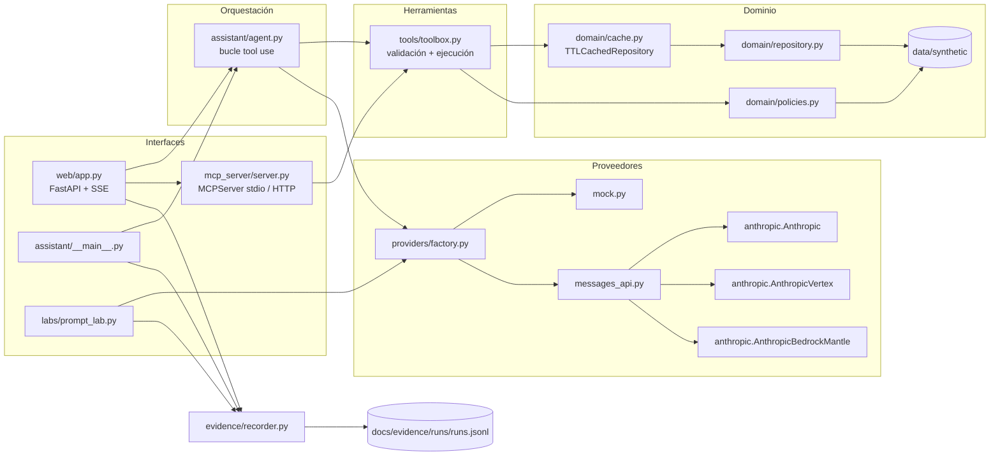
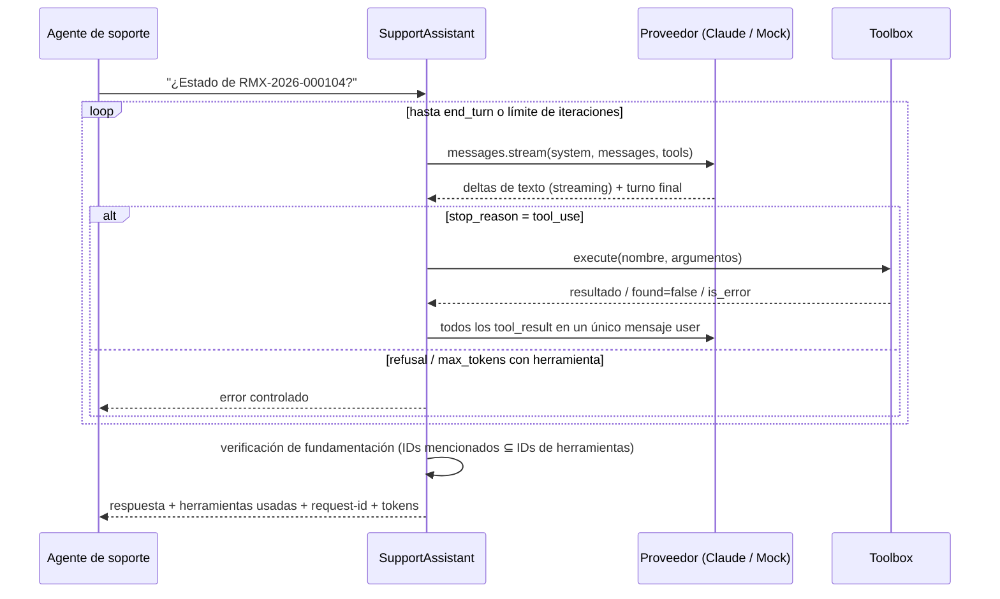

# Arquitectura

## Principios
1. **Separación de capas**: la lógica de negocio no conoce a los proveedores de modelo; las herramientas no conocen el bucle.
2. **Una sola fuente de validación**: el `Toolbox` valida y ejecuta herramientas para el asistente (Proyectos 2, 4, 5, 6) y para MCP (Proyecto 7).
3. **Un adaptador, tres plataformas**: Claude API, Vertex AI y Bedrock exponen la misma superficie `messages.stream`; las diferencias se declaran en la fábrica.
4. **Seguro por defecto**: sin credenciales y sin `CFL_ALLOW_LIVE_CALLS=true`, todo proveedor real queda en PENDIENTE.
5. **Evidencia auténtica**: cada ejecución se registra con los datos disponibles y `null` en lo demás.

## Diagrama de componentes

## Flujo de una consulta (Proyecto 2)

## Decisiones de diseño
| Decisión | Alternativa descartada | Motivo |
|----------|------------------------|--------|
| Bucle manual de tool use | Tool Runner beta del SDK | Control explícito del límite de iteraciones, del registro de herramientas y del manejo de `max_tokens`/`refusal`, que es lo que el laboratorio quiere demostrar |
| `found=false` como resultado válido | Tratar "no existe" como error | El modelo no debe reintentar: la consulta fue correcta y la respuesta es "no existe" |
| Validación pydantic con `extra="forbid"` | Confiar en el esquema JSON | Con `eager_input_streaming` el servidor no valida el input; la validación en cliente es obligatoria |
| Caché como decorador | Modificar el repositorio | Mantiene el origen simple y la caché desactivable (`TTL=0`) y probable por separado |
| Mock determinista y etiquetado | Respuestas "realistas" simuladas | Permite demostrar el flujo sin presentar texto como si fuera de Claude |
| `AnthropicBedrockMantle` | `AnthropicBedrock` (InvokeModel) | Es el cliente vigente para Opus 4.7+ y comparte la superficie Messages API |
| Interruptor `CFL_ALLOW_LIVE_CALLS` | Solo presencia de credenciales | Evita consumo facturable accidental cuando hay credenciales en el entorno |

## Versiones verificadas (2026-10-23)
`anthropic 2.2.0` (API version por defecto `2026-10-21`), `mcp 2.3.0` (API v2), `fastapi 0.161.1`, `pydantic 2.14.1`,
`pytest 9.1.1`. Modelos: `claude-opus-5-5` (API/Vertex), `anthropic.claude-opus-5-5` (Bedrock).
